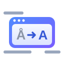

<div align="center">



# Polyglass

**A translating lens for your desktop. Private, on-device, open source.**

[](https://github.com/shashankshirol/polyglass/actions/workflows/ci.yml)
[](./LICENSE)
[](https://github.com/shashankshirol/polyglass/stargazers)
[](https://github.com/shashankshirol/polyglass/issues)
[](https://github.com/shashankshirol/polyglass/commits/main)
[](https://github.com/shashankshirol/polyglass)
[](#requirements)

</div>

Polyglass shows a movable lens over your desktop. Text under the lens is recognized and
translated in near real time, and the translation is drawn inside the lens. Everything runs on
your computer: no screen images or text leave it.

> **Status:** pre-alpha, Windows only. Swedish ↔ English is the tested language pair.

## Features

- **Live lens:** drag it over any window; the translation appears once the lens stops moving.
- **On-device:** Windows OCR and CTranslate2 with Helsinki-NLP's OPUS-MT models. No online
  services, no telemetry ([PRIVACY.md](./PRIVACY.md)).
- **Three modes:** Overlay (translation drawn over the text), Panel (translations listed in a
  strip beside the lens) and Freeze (translate a still picture of the screen).
- **Swedish ↔ English** out of the box; German → English can be
  [set up by hand](./docs/DEVELOPMENT.md#optional-german--english). Language pairs come from
  the model catalog, not from code.
- **Yours to adjust:** frame colour, opacity, font and text size, and rebindable global hotkeys
  that don't break AltGr characters on the Swedish keyboard.

## Requirements

- Windows 10 version 2004 or newer, x64.
- For Swedish source text: the Swedish OCR feature (Windows Settings → Time & language →
  Language & region → add Swedish → Optical character recognition). Without it the lens reads
  English only.

## Quick start

There are no installers yet, so you build from source. You need Rust 1.90+, Node.js 20+, the
Microsoft C++ Build Tools, CMake and Ninja
([details](./docs/DEVELOPMENT.md#1-prerequisites)).

```
cd apps/desktop
npm install
npm run tauri dev
```

The first build compiles the translation engine and takes a few minutes.

### First run

The translation models aren't bundled (about 170 MB for both directions). On first launch a
welcome window offers to download them; nothing is downloaded until you choose **Download**,
and every file is checked against its SHA-256.

To build and install the same files yourself instead (needs Python 3.12+), run this from the
repository root, then restart Polyglass:

```
python scripts/models/opus_mt.py
```

More options, including importing model files from a folder, are in
[docs/DEVELOPMENT.md](./docs/DEVELOPMENT.md#3-first-run-get-the-translation-models).

## Using the lens

- Drag the toolbar to move the lens; drag an edge or corner to resize it.
- The two pickers in the toolbar choose the source and target language.
- Toolbar buttons: mode (Overlay/Panel), ❄ freeze, ⇄ swap direction, ❚❚ pause, ⇲ click-through,
  ⚙ settings, ✕ hide. The tray icon shows or hides the lens.

| Hotkey | Action |
|---|---|
| Ctrl+Alt+L | Show or hide the lens |
| Ctrl+Alt+F | Freeze the screen under the lens (Esc to leave) |
| Ctrl+Alt+C | Copy the translation |
| Ctrl+Alt+S | Swap the languages |
| Ctrl+Alt+T | Turn click-through on or off |

Hotkeys can be changed or turned off in Settings → Hotkeys. While the lens is hidden, nothing
is captured.

## Documentation

| Document | What it is |
|---|---|
| [docs/DEVELOPMENT.md](./docs/DEVELOPMENT.md) | Building, models, tests, developer flags, troubleshooting |
| [docs/ARCHITECTURE.md](./docs/ARCHITECTURE.md) | How the code is organized |
| [docs/RELEASING.md](./docs/RELEASING.md) | How releases are built, signed and verified |
| [SPEC.md](./SPEC.md) | Product requirements with IDs and acceptance criteria |
| [PLAN.md](./PLAN.md) | Architecture, decisions, roadmap |
| [CHECKLIST.md](./CHECKLIST.md) | Development tracker and session log |
| [PRIVACY.md](./PRIVACY.md) | What data goes where |
| [CONTRIBUTING.md](./CONTRIBUTING.md) | How to contribute |

## License

[Apache-2.0](./LICENSE). Fixtures under `tests/fixtures` are CC0-1.0. Translation models are
installed separately, not bundled, and carry their own licenses (listed in
`models/manifest.toml`; the OPUS-MT models by Helsinki-NLP are CC-BY-4.0).
